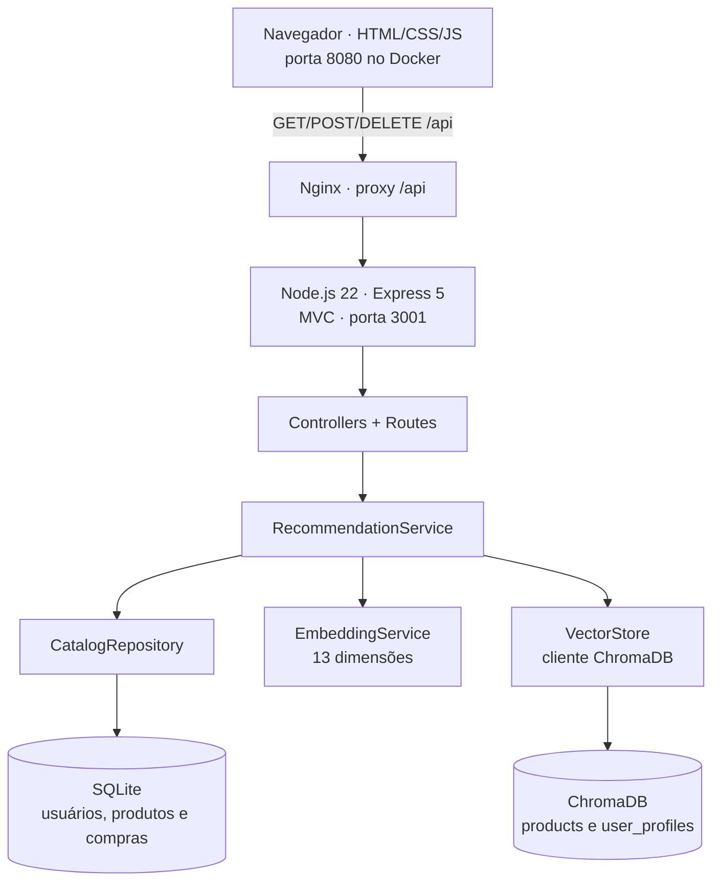
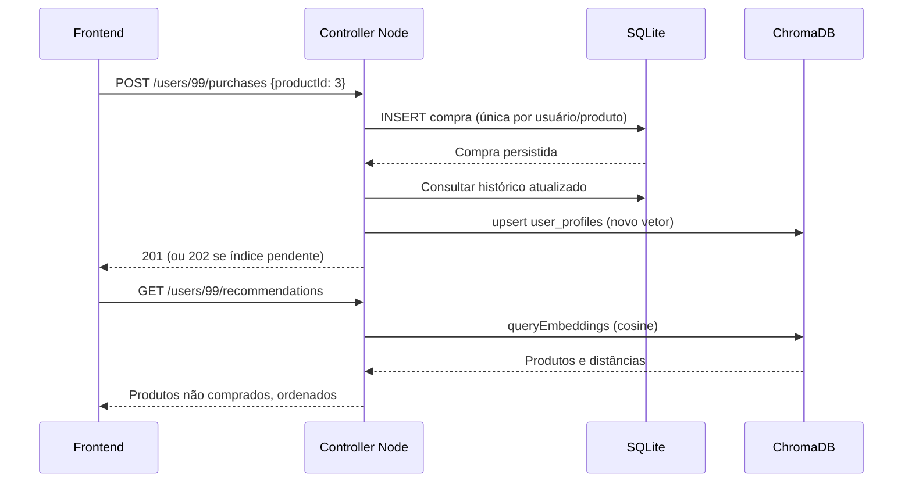

# VectorShop — laboratório de recomendação com Node.js 22 + ChromaDB

Projeto didático inspirado no exemplo de e-commerce do módulo 01 da formação Engenharia de Software com IA Aplicada.

**Objetivo:** separar frontend e backend, manter usuários/produtos/compras no servidor, persistir o histórico em SQLite e recomendar novos produtos por **busca vetorial no ChromaDB**. A aplicação executa localmente no Linux XFCE sem GPU e sem serviços pagos de IA.

> **Importante:** esta versão é de **recomendação baseada em conteúdo (content-based filtering)**. Não treina uma rede neural TensorFlow como o projeto original. O ChromaDB é o mecanismo de busca vetorial, não um substituto de uma rede neural. Os vetores são calculados por regras determinísticas; não são embeddings de um LLM. O score é uma **similaridade**, e não uma probabilidade calibrada de compra.

## 1. Visão geral da arquitetura



Em termos simples:

1. A página pede os usuários e produtos à API Node.js. **Não há JSON de usuários/produtos no frontend.**
2. A API busca os registros no SQLite; os dados iniciais de exemplo são carregados **uma única vez** pelo backend.
3. Os produtos são convertidos em vetores numéricos e indexados no ChromaDB.
4. A cada compra/removal de compra, o SQLite é atualizado e o perfil vetorial é recalculado no ChromaDB.
5. Para recomendar, o backend calcula o vetor médio dos produtos comprados e consulta os vizinhos mais próximos no ChromaDB.
6. A API elimina produtos já comprados e retorna a lista ordenada para o frontend.
7. Se o usuário nunca comprou, não inventa preferências: usa a popularidade (cold start).

### Papéis dos bancos

| Componente | Armazena | Por quê |
|---|---|---|
| **SQLite** | Usuários, produtos, relações de compra | Dados transacionais, integridade referencial, restrição de duplicidade |
| **ChromaDB** | `ecommerce_products_v1`, `ecommerce_user_profiles_v1`, vetores e metadados | Consultas rápidas por proximidade vetorial, distância cosseno |

O SQLite é **fonte de verdade**. O Chroma é um índice **reconstruível**. Isso evita usar um banco vetorial como banco transacional. Ambos rodam somente no backend/infraestrutura.

## 2. Estrutura

```text
vector-shop/
├── compose.yaml                      # Chroma + API + frontend com Nginx
├── README.md
├── nginx/
│   └── default.conf                  # Proxy HTTP /api para a API
├── frontend/
│   ├── Dockerfile
│   ├── index.html                     # Interface responsiva
│   ├── style.css
│   └── app.js                         # Apenas chamadas fetch para a API
└── backend/
    ├── Dockerfile
    ├── package.json
    ├── .env.example
    ├── src/
    │   ├── server.js                  # Bootstrap, conexão e reinicialização de índices
    │   ├── app.js                     # Middleware e erros HTTP
    │   ├── config/env.js
    │   ├── routes/apiRoutes.js        # Rotas REST
    │   ├── controllers/catalogController.js
    │   ├── models/database.js        # Esquema SQLite e seed
    │   ├── repositories/catalogRepository.js
    │   ├── data/seed.js               # Dados iniciais somente no backend
    │   ├── services/embeddingService.js
    │   ├── services/vectorStore.js
    │   └── services/recommendationService.js
    └── test/
        ├── embedding.test.js
        └── recommendation.test.js
```

## 3. Executar com Docker Compose (mais fácil)

Pré-requisitos: **Docker Engine** com plugin `docker compose` ou **Podman** com `podman compose`, ambos com Compose operacional. A imagem Node usada é `node:22-alpine`, e a imagem Chroma é `chromadb/chroma:1.5.9`.

No terminal dentro da pasta do projeto:

```bash
docker compose up -d --build
```

No Linux XFCE com Podman, se você tiver um provedor de Compose compatível:

```bash
podman compose up -d --build
# Alternativa, se instalada:
# podman-compose up -d --build
```

Depois, acesse:

| Serviço | URL |
|---|---|
| **Frontend** | http://localhost:8080 |
| **Backend REST** | http://localhost:3001/api |
| **Saúde** | http://localhost:3001/api/health |
| **ChromaDB HTTP** | http://localhost:8000 |

O Compose mapeia as portas **somente para `127.0.0.1`**. No Docker, Chroma recebe persistência no volume `chroma-data`, e SQLite em `sqlite-data`.

Acompanhar logs:

```bash
docker compose ps
docker compose logs -f api
docker compose logs -f chroma
```

Parar preservando os dados:

```bash
docker compose down
```

**Cuidado:** `docker compose down -v` remove os volumes e **apaga os dados** do laboratório.

### Se a API demorar a subir

Chroma pode iniciar depois do backend. O backend tenta conectar por cerca de 45 segundos antes de encerrar; o Compose está configurado para reiniciá-lo quando necessário.

## 4. Executar no Linux XFCE sem container para Node e frontend

Requer Node **22** (de preferência 22.13 ou mais recente da linha 22), `npm` e Python com `venv`/`pip` se for rodar Chroma sem container. `node:sqlite` no Node 22 ainda pode mostrar **ExperimentalWarning**, mas não precisa de driver nativo adicional.

### 4.1 Subir somente o Chroma via Docker/Podman

Se quiser evitar instalar Chroma no Linux, use somente um container:

```bash
docker run -d --name vectorshop-chroma \
  -p 127.0.0.1:8000:8000 \
  -v vectorshop-chroma-data:/data \
  -e CHROMA_PERSIST_PATH=/data \
  chromadb/chroma:1.5.9
```

Para Podman, substitua `docker` por `podman`.

### 4.2 Alternativa: Chroma totalmente sem Docker

Em um terminal **à parte**:

```bash
python3 -m venv .venv-chroma
source .venv-chroma/bin/activate
python -m pip install 'chromadb==1.5.9'
chroma run --host 127.0.0.1 --port 8000 --path ./chroma-local
```

A instalação inicial exige conexão à internet. Se `chroma run` não estiver disponível na versão do Python que você tem, use o container do passo 4.1.

### 4.3 Iniciar o backend

Em outro terminal:

```bash
cd backend
npm install
npm test
npm run dev
```

A API responde em `http://localhost:3001/api`. O arquivo `backend/.env.example` documenta as configurações; para iniciar sem Compose, o backend já usa valores padrões em `src/config/env.js`. Para alterar configurações, exporte as variáveis no terminal, por exemplo:

```bash
export PORT=3001
export CHROMA_URL=http://127.0.0.1:8000
export DB_PATH=./data/ecommerce.sqlite
npm run dev
```

### 4.4 Iniciar o frontend

Em outro terminal, a partir da raiz do projeto:

```bash
python3 -m http.server 5173 --directory frontend --bind 127.0.0.1
```

Abra: **http://localhost:5173**. Nesta porta, o frontend direciona automaticamente as chamadas para `http://localhost:3001/api`. Para qualquer outra porta, ajuste a constante `API` em `frontend/app.js`.

## 5. Endpoints REST

| Método | Endpoint | Resultado |
|---|---|---|
| `GET` | `/api/health` | Estado de SQLite e Chroma |
| `GET` | `/api/users` | Lista perfis sem dados de compra |
| `GET` | `/api/users/1` | Perfil com histórico de compras |
| `GET` | `/api/products` | Produtos com nome, categoria, cor e preço |
| `GET` | `/api/users/1/recommendations?limit=5` | Recomendações ordenadas |
| `POST` | `/api/users/99/purchases` | Registra compra `{"productId":3}` |
| `DELETE` | `/api/users/99/purchases/3` | Remove a compra do produto 3 |

Exemplos de chamadas reais:

```bash
curl -s http://localhost:3001/api/users
curl -s http://localhost:3001/api/products
curl -s 'http://localhost:3001/api/users/1/recommendations?limit=5'

curl -i -X POST http://localhost:3001/api/users/99/purchases \
  -H 'Content-Type: application/json' \
  -d '{"productId":3}'

curl -s 'http://localhost:3001/api/users/99/recommendations?limit=5'

curl -i -X DELETE http://localhost:3001/api/users/99/purchases/3
```

### Exemplo do retorno de recomendação

```json
{
  "user": {"id": 1, "name": "Ana Lima", "age": 25},
  "mode": "similaridade-vetorial",
  "note": "Score é similaridade cosseno aproximada, não probabilidade de compra.",
  "recommendations": [
    {"id": 3, "name": "Caixa de Som Bluetooth", "category": "eletrônicos", "color": "azul", "price": 89.99, "score": 0.8}
  ]
}
```

**Atenção:** esse JSON ilustra a **estrutura**, não um resultado medido. Os scores e a ordem dependem dos vetores e dos dados de compras.

## 6. Vetorização — explicação para iniciantes

Uma máquina não entende naturalmente que `eletrônicos` e `azul` são características de um produto. Transformamos cada atributo em uma **posição numérica** do vetor:

```text
[categorias (4) | cores (8) | preço (1)]
          4      +     8     +    1    = 13 números
```

**Categoria/cor:** one-hot encoding (uma posição ativada por valor). **Preço:** dividido por 200 e limitado a 1. Os grupos recebem pesos de **55% categoria**, **30% cor**, **15% preço**, ajustados por raiz quadrada antes da normalização para que as contribuições do cosseno sejam mais próximas dessas proporções.

```text
Produto A -> [0.71, 0, 0, 0, 0.63, 0, ... , 0.27]
Produto B -> [0.71, 0, 0, 0, 0, 0.63, ... , 0.18]
Usuário   -> média normalizada dos vetores dos produtos comprados
```

*Os números acima ilustram a ideia, não são valores exatos calculados pelo código.*

A consulta no ChromaDB usa **similaridade cosseno**. Quanto menor a distância, maior a proximidade. A aplicação converte distância em score visual (`1 - distance`, limitado ao intervalo 0–1).

**Importante:** vetores numéricos estruturados são diferentes de embeddings semânticos de texto. Este método aproxima produtos por atributos explícitos; não entende descrições em linguagem natural.

### Cold start

Usuário `99`, **Josézin da Silva**, começa sem compras. Sem histórico, não há base confiável para construir um vetor de preferências. O sistema recomenda por popularidade. Ao comprar algo, as próximas recomendações já passam a usar o ChromaDB.

### Quando o usuário compra



## 7. Testes de laboratório

O backend inclui testes unitários com **`node:test`**, sem instalar frameworks de teste:

```bash
cd backend
npm test
```

| Cenário | Passo | Resultado esperado |
|---|---|---|
| Usuário sem compras | Selecionar Josézin (99) | Aparecem produtos populares; sem score personalizado |
| Personalização | Josézin compra Caixa de Som (3) | Perfil passa para busca vetorial e o item comprado desaparece das sugestões |
| Recomendação por interesse | Selecionar Ana (1) | Sugestões priorizam produtos próximos do histórico eletrônico |
| Compra duplicada | POST produto 1 duas vezes para a mesma pessoa | Segunda solicitação retorna HTTP 409 |
| Remover compra | Clicar no `×` do histórico | Compra removida e recomendações recalculadas |
| Persistência | Reiniciar containers sem `-v` | Compras permanecem salvas |
| Erro de ID | GET `/api/users/abc` | HTTP 400 |
| Usuário inexistente | GET `/api/users/7777` | HTTP 404 |

### Conferir o backend independentemente do frontend

```bash
curl http://localhost:3001/api/health
```

Esperado quando todos os serviços estiverem prontos:

```json
{"status":"ok","sqlite":"ok","chroma":true}
```

## 8. Limitações conhecidas / evolução

1. **Não é uma recomendação neural:** falta treinar TensorFlow.js com pares de usuário/produto e comparar com a linha de base vetorial.
2. **Amostra pequena:** dez produtos e cinco usuários com histórico; não há validação estatística de qualidade.
3. **Sem autenticação:** laboratório local. **Não exponha a aplicação na internet** sem autenticação, autorização por usuário, rate limiting, logs estruturados e TLS.
4. **Sem validação semântica via LLM:** vetores são estruturados, não embeddings de frases. Para texto livre, integrar um encoder local (por exemplo, Ollama) como uma evolução opcional.
5. **Índice eventual:** SQLite é a fonte de verdade. Se Chroma falhar depois de uma compra, a API salva a compra e informa `indexSynced: false`. Ao reiniciar, a indexação é refeita. A consulta personalizada usa o histórico atual no SQLite como vetor de entrada.
6. **Catálogo fixo após seed:** nesta versão, a API de leitura é pública localmente; não foram implementados endpoints administrativos para criar/alterar produtos e usuários.
7. **SQLite é local:** adequado a laboratório e API única, não a múltiplas instâncias com escrita distribuída.
8. **Dimensionamento:** a coleção `_v1` usa dimensão fixa 13. Ao alterar os atributos ou a dimensão, crie coleção `_v2` e reindexe; não misture vetores de dimensões diferentes.

### Evolução sugerida (fase 2)

- Adicionar uma rede TensorFlow.js (Node.js, versão JS pura) para **reranking** após o Chroma selecionar candidatos.
- Reservar histórico de compras para avaliação offline, evitando vazamento de rótulo do projeto original.
- Medir `Precision@K`, `Recall@K`, `NDCG@K` e cobertura de catálogo antes de dizer que o modelo melhorou.
- Adicionar OpenAPI/Swagger, paginação, testes de integração com containers, autenticação JWT e observabilidade.

## 9. Fontes utilizadas

- Projeto de referência: https://github.com/unipds-engenharia-de-ia-aplicada/engenharia-de-software-com-ia-aplicada/tree/main/modulo01-fundamentos-de-ia-e-llms-para-programadores/exemplo-01-ecommerce-recomendations-z/parte05-ecommerce-recomendations-with-tensorflow
- Cliente JavaScript Chroma: https://www.npmjs.com/package/chromadb
- Chroma Cookbook: https://cookbook.chromadb.dev/
- SQLite do Node.js 22: https://nodejs.org/api/sqlite.html

---

**Nota de implementação:** o código foi validado localmente com testes de módulo e análise de sintaxe, mas o ambiente de geração não disponibilizava um servidor Chroma/container Docker para executar testes ponta a ponta. Execute o roteiro de testes de integração na sua máquina Linux XFCE.
